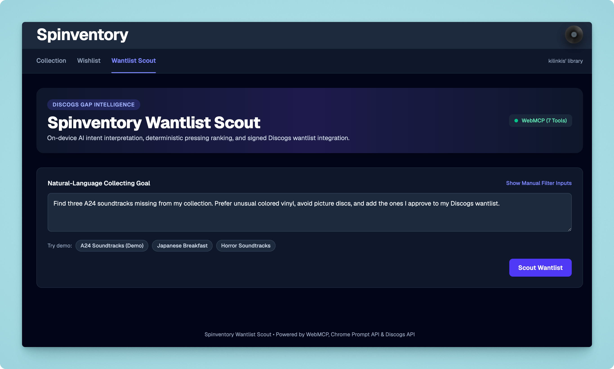
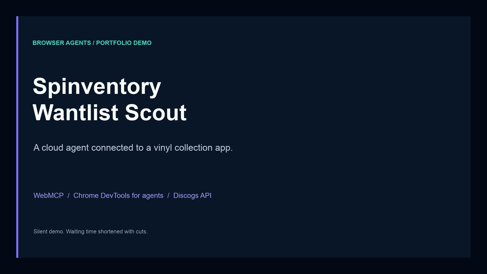
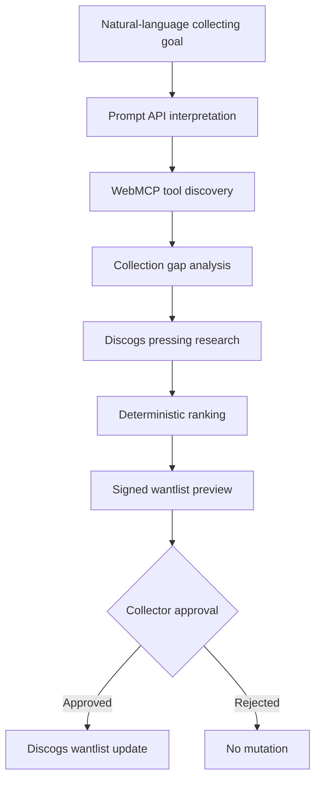
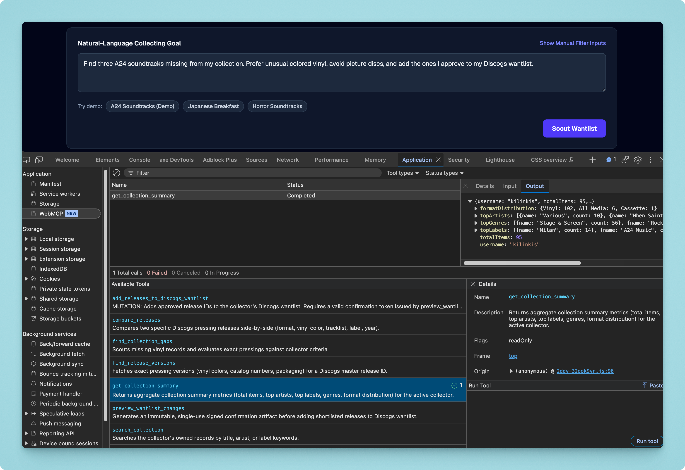

# Spinventory Wantlist Scout

An agentic vinyl-discovery experience built with the Chrome Prompt API,
WebMCP, Chrome DevTools for agents, and the Discogs API.

[Try the live demo](https://spinventory.app/kilinkis/scout?portfolio) · [Watch the 74-second demo](#demo)

> The production application is maintained in a private repository.
> This public repository documents the product, architecture, tool
> contracts, safety model, and demo workflow.

## Overview

Spinventory Wantlist Scout helps record collectors discover specific
pressings missing from their collection.

A collector can describe a goal in natural language, such as:

> Find three A24 soundtracks missing from my collection. Prefer unusual
> colored vinyl, avoid picture discs, and add the ones I approve to my
> Discogs wantlist.

The application interprets those preferences, examines the collector's
existing library, finds suitable Discogs releases, and ranks exact
pressings.

Through WebMCP, compatible agents can discover and invoke the same
capabilities programmatically.

## Demo

**[Watch the demo — 74 seconds](https://github.com/kilinkis/spinventory-wantlist-scout-showcase/raw/refs/heads/main/assets/demo/spinventory-webmcp-demo.mp4)** · [Download the MP4](assets/demo/spinventory-webmcp-demo.mp4) · [Caption file](assets/demo/spinventory-webmcp-demo.srt)

A Gemini agent in Antigravity CLI invokes Spinventory's WebMCP tools to inspect
the collection, research exact vinyl pressings, and add three releases to the
Discogs wantlist after the collector approves. Chrome DevTools shows the
completed preview and mutation calls, and Spinventory's wishlist reflects the
additions.

This recording demonstrates the cloud-agent workflow. The app's on-device
Prompt API is a separate capability for interpreting goals entered through the
UI. The video is silent, with captions; waiting time is shortened with cuts.

## Why WebMCP

Traditional browser automation has to infer intent from the rendered page and
then reproduce a sequence of clicks and keystrokes. That can work, but it ties
the agent to presentation details that may be ambiguous or change over time.

Spinventory exposes a compact, typed capability surface alongside its human
interface. Agents can discover named tools, inspect their input schemas, and
call application logic directly while the collector remains on the page.

| UI-only browser automation | Spinventory with WebMCP |
| --- | --- |
| Infers meaning from DOM structure and labels | Discovers tools with explicit names and descriptions |
| Replays a potentially long sequence of UI actions | Invokes the relevant application capability directly |
| Depends on selectors and layout details | Depends on a versioned, structured tool contract |
| Must infer whether an action is sensitive | Distinguishes read, preview, and mutation operations |
| May obscure the state used by the action | Runs in the page context with the active collector and visible UI |

Chrome for Developers illustrates this distinction in a short comparison:

## Agentic workflow

## WebMCP tools

The Scout page exposes seven structured tools that compatible agents can
discover and invoke through Chrome DevTools for agents.

*Chrome DevTools discovers Spinventory’s WebMCP tools and shows a
successful invocation of the read-only `get_collection_summary` tool.*

| Tool | Purpose | Type |
| --- | --- | --- |
| `search_collection` | Searches owned records by title, artist, or label | Read-only |
| `get_collection_summary` | Returns collection statistics and format distribution | Read-only |
| `find_collection_gaps` | Finds records missing from the collector's library | Read-only |
| `find_release_versions` | Retrieves exact Discogs pressing editions | Read-only |
| `compare_releases` | Compares two pressings side by side | Read-only |
| `preview_wantlist_changes` | Creates a signed preview of the proposed changes | Preview |
| `add_releases_to_discogs_wantlist` | Adds approved releases to the collector's Discogs wantlist | Mutation |

## Human-controlled mutations

Wantlist updates use a two-stage transaction:

1. The agent selects exact Discogs release IDs.
2. `preview_wantlist_changes` returns an immutable preview and confirmation token.
3. The collector reviews and explicitly approves the preview.
4. `add_releases_to_discogs_wantlist` validates the token and performs the mutation.

The mutation tool cannot silently choose additional releases or bypass the preview step.

## Technology

- WebMCP for agent-discoverable page capabilities
- Chrome Prompt API for on-device intent interpretation
- Chrome DevTools for agents for browser and WebMCP automation
- Discogs API and OAuth for collection and wantlist integration
- Deterministic application logic for pressing selection and ranking
- Progressive enhancement for browsers without the Prompt API

## Browser support

WebMCP and the Prompt API are experimental browser capabilities. The core
Spinventory experience remains usable without them through progressive
enhancement and manual inputs.

For background, see Chrome's official [WebMCP overview](https://developer.chrome.com/docs/ai/webmcp)
and the community group's [WebMCP explainer](https://github.com/webmachinelearning/webmcp).

## About this repository

This public repository is a technical case study for Spinventory
Wantlist Scout. It contains product documentation, architecture notes,
screenshots, and demo materials. The production application is actively
developed in a private repository.
